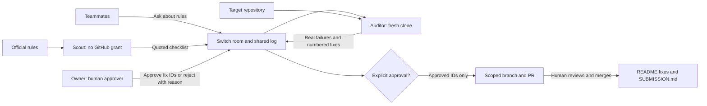

# Ship Check

Hackathon teams lose points to broken setup instructions and missed submission rules.
Ship Check puts quoted rules, fresh-clone evidence and human-approved fixes in a Switch room.

**Status:** step-one scaffold. Agent prompts and a standalone template are drafted;
the live Switch → audit → approval → PR workflow has not been exercised yet.
**Demo video:** pending recording and upload.



## Local setup

Requires Git and Python 3.10+ with IANA time-zone data (included on macOS). The
utilities use only Python's standard library. Clone this repository using its
actual GitHub URL after it is published, then enter the checkout. No Python
package installation is needed.

```sh
python3 -m unittest discover -s tests -v
python3 scripts/tz.py '2026-11-07T23:59:00+05:30'
```

Expected conversion: `IST: 2026-11-07T23:59:00+05:30` and
`UTC: 2026-11-07T18:29:00+00:00`. This is an arithmetic example, not a verified
hackathon deadline. The original rule quote and time zone must accompany every
deadline in a real checklist.

Save rules for scout when agent browsing is unavailable:

```sh
python3 scripts/fetch_rules.py https://nearhackathon.com/HACKATHON.md --slug near
```

This creates `scout/inputs/near.txt` and `near.source.json` with retrieval metadata.
Snapshots are not overwritten; use a new slug when refreshing. HTML extraction
removes scripts/styles and normalizes whitespace. It cannot recover content
rendered only by JavaScript; paste a source-labelled rules file when necessary.

## Set up Switch (next build step)

1. Install [Switch Console for macOS Apple silicon](https://github.com/sandbox-quantum/switch/releases/latest)
   and follow the [official getting-started guide](https://docs.switchagents.ai/switch-rooms/getting-started)
   for its local prerequisites, including Docker Desktop for bundled Mattermost.
2. Sign in to Codex and confirm the provider is available in Switch Console.
   Link your messaging account so the template can add its creator to the room.
3. Connect GitHub through Switch with write access to **one test repository**.
   Do not rely on shell-profile credentials being available to agents.
4. Import [ship-check.template.yaml](switch/ship-check.template.yaml) on the
   Console's Templates page. Enter a unique `team` prefix and GitHub `owner/name`.
   Choose Mattermost if desired; `$first` means the server's default bridge.
5. Review each agent's machine and directory **before creation**. Defaults are
   separate folders under Switch's agents directory. To use this checkout's
   `scout/` and `audit/`, set their absolute paths in Advanced. The template embeds
   all instructions and works without this checkout on the agents' machines.
6. Inspect kickoff replies, the aliases and the GitHub grant. See
   [verification notes](switch/VERIFICATION.md) before claiming a successful run.

The template's provider order is Codex, Claude, OpenCode. Select Codex explicitly
if it is required for the demo. `auto_mode: true` allows provider review;
`auto_approve: false` retains tool permission checks. Neither setting implements
the business approval gate, which is currently an instruction enforced by the
auditor. The owner must send explicit numbered approvals in the room.

## Do X, see Y — planned rehearsal

Create a separate test repository from [the broken fixture](examples/README.md),
and import the template with that test repository's owner/name.

1. Send `@scout check https://www.wemakedevs.org/hackathons/switch`.
   Expect a checklist with source quotes, deadline zones and unresolved questions.
   If the rules are unavailable, supply a saved source. The checked-in Flip the
   Switch and NEAR examples are pending-verification stubs.
2. For a deterministic fixture test, provide the complete contents of
   [the synthetic checklist](examples/checklists/sample-project.md) in the room.
   Send `@audit audit https://github.com/OWNER/TEST-REPO using that checklist`.
   Expect a fresh clone, the missing-requirements error, missing project-root
   LICENSE and demo link, advisory scores, and numbered fixes. These are expected
   results, not a claim that a live audit has happened.
3. In the report thread, the owner sends `@audit approve 1, 3` **after checking
   what those IDs mean**. Reject another ID with a reason. Expect only the
   approved edits on a branch and a real PR URL. Include SUBMISSION.md among
   approved IDs if it should be written; it is not implicitly authorized.
4. Review the diff, then merge manually. Record the demo and add its actual URL.
5. Ask scout to check `https://nearhackathon.com/HACKATHON.md` to demonstrate a
   second rule source; do not borrow rules or deadlines from the first event.

Use exact agent names if aliases fail. Check threaded replies before assuming an
agent is silent. If no session is connected, `!run-cmd` prints the command to
start it. An addressing refusal from a non-owner is expected for the auditor.
Room checks for the live rehearsal: `!list-agents`, `!agents-status`,
`!list-aliases`, `!roles`, `!list-documents`.

## Why Switch is part of the workflow

Without Switch, this workflow loses its shared handoff and decision record:
scout's checklist does not reach the auditor in front of the team, teammates
cannot ask rule questions or inspect audit output in one place, and approvals
and rejection reasons disappear into separate terminal sessions. With Switch,
the team works from one room's checklist, evidence and human decision history.
The Python helpers alone do not provide this collaboration.

| Switch feature | Use in Ship Check |
| --- | --- |
| Rooms and shared log | Checklist handoff, real output and decision record |
| Room instructions | Source quoting, failure evidence and approval policy |
| Aliases | `scout` and `audit` map to team-prefixed agent names |
| Addressing | Anyone may ask scout; auditor accepts owner and owner's agents |
| Scoped GitHub connection | Only auditor receives write access to one repository |
| Exclusive role | Requested `approver` coordination role; not a human authorization mechanism |
| Template and kickoff | One YAML draft creates both agents and their room |

Switch roles are documented as agent-held leases. Human role assignment is
unverified; this draft uses the auditor's owner as the sole human approver. A
role never expands access. See [the documented limitation](switch/VERIFICATION.md).

## Repository map

- `switch/`: standalone template, room policy and verification notes.
- `scout/`: scout instructions, saved source inputs and checklist output folder.
- `audit/`: auditor instructions; fresh clones and logs go in ignored `runs/`.
- `scripts/`: rules fetcher, deadline converter, report and submission templates.
- `examples/`: deliberately broken project, synthetic checklist and event stubs.
- `tests/`: small offline utility tests, including a local HTTP fetch.

## Remaining submission work

- [ ] Run scout against both official sources and replace the checklist stubs.
- [ ] Complete a real fresh-clone audit and owner-approved PR rehearsal.
- [ ] Recreate the room from the template with a fresh team prefix and verify access.
- [ ] Audit Ship Check itself; review and merge its resulting fixes.
- [ ] Publish the repository and upload a playable demo; add real URLs here.
- [ ] Verify official deadline, eligibility and submission requirements with quotes.
- [ ] Complete any optional prize evidence separately from mandatory submission items.

MIT licensed. Never commit secrets, post publicly or submit forms on a teammate's behalf.
