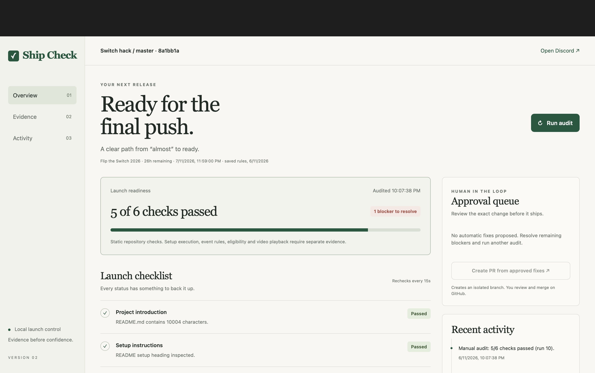
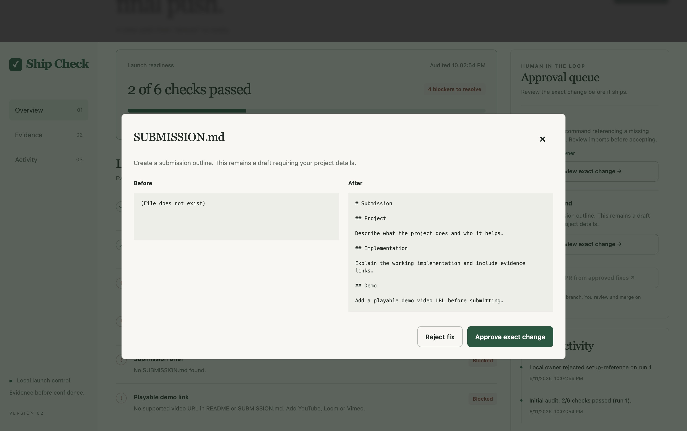

# V2 verification — 6 November 2026

## Scout rules integration update

- Scout Markdown now imports directly into individual source-backed event checks.
- Live API and Safari selection tests loaded 58 Flip the Switch rules and 74
  NEAR rules. Switching events did not retain the other event's deadline.
- Required checks affect readiness; optional and unselected conditional prize
  requirements remain unscored. Conditional checks become applicable only after
  an owner result. All imported requirements initially need evidence review.
- Safari verified exact quotes, official source links, review controls, missing
  evidence validation and cancellation without recording a real assertion.
- 22 tests pass, covering source parsing, checked boxes not being proof, required
  versus optional scoring, missing quotes, duplicate IDs, evidence persistence,
  stale evidence, event isolation and the existing PR workflow.
- Current captures and source hashes: [rules visual receipt](rules-evidence/visual-evidence.json).
  The original captures below describe the earlier six-check build.

- Local dashboard: http://127.0.0.1:8787. Main project has 5/6 static checks;
  the demo video URL remains missing.
- Discord API read-back confirmed readiness embeds and Run audit / Create
  approved PR controls delivered to `#ship-check-demo`.
- Safari exercised manual audit, exact review, rejection and separate approval
  in a disposable fixture. No main-project fixes were approved by these tests.
- Adding the missing fixture requirements file triggered an automatic recheck:
  2/6 → 3/6 checks, with old approvals reset and PR control disabled.
- 14 Python tests pass. JavaScript syntax and Git whitespace checks pass.
- PR tests create real isolated Git worktrees and commits; push and PR creation
  are mocked. V2 Discord clicks through a live PR have not been rehearsed.
  V1's PR #1 remains separate evidence.
- Desktop was visually inspected. Narrow viewport verification is pending.
  See the [visual receipt](v2-evidence/visual-evidence.json).

